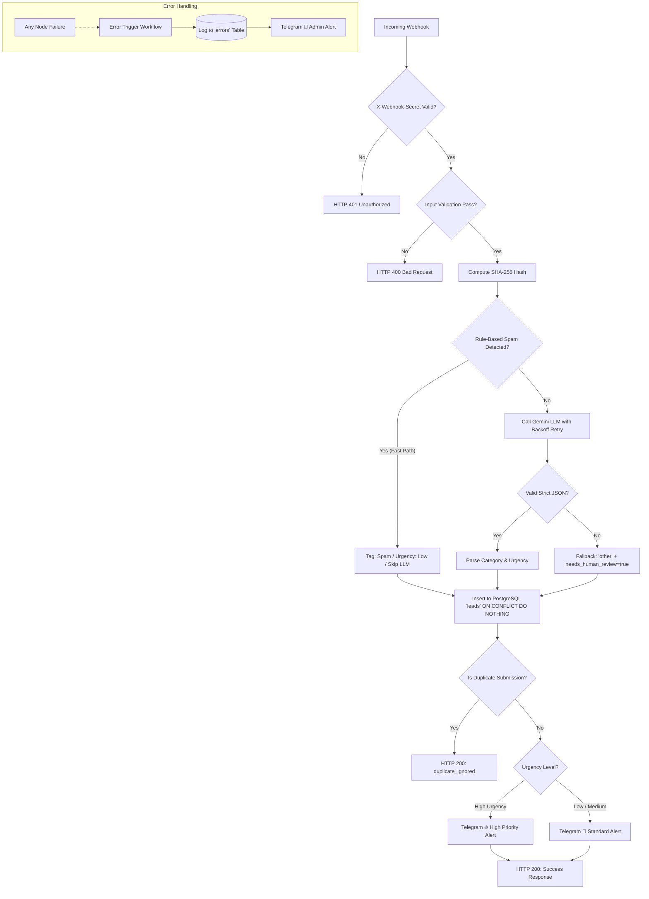

# 🚀 AI Lead Triage Automation (Self-Hosted n8n + PostgreSQL + Gemini)

Proyek otomatisasi enterprise-grade untuk mengklasifikasikan, memvalidasi, menyimpan, dan merutekan prospek pesan masuk (contact form / webhook) secara cerdas menggunakan **self-hosted n8n**, **Google Gemini LLM**, dan **PostgreSQL**, dengan notifikasi instan via **Telegram**.

---

## 📌 1. Masalah yang Diselesaikan (Problem Statement)

Banyak bisnis kehilangan peluang atau lambat merespons pelanggan karena:
1. **Penyortiran Manual yang Lambat**: Pesan prospek bernilai tinggi (*high-value sales*) bercampur dengan keluhan kritis (*outage/down*) dan pesan spam biasa.
2. **Biaya & Latensi LLM yang Boros**: Mengirim setiap spam atau pesan sampah langsung ke LLM membuang kuota API token dan memperlambat pemrosesan.
3. **Risiko Data Duplikat**: Pengunjung web sering menekan tombol submit berkali-kali atau webhook mengalami *retry* jaringan, menyebabkan duplikasi data di CRM/database.
4. **Resiko Kegagalan Parsing JSON LLM**: LLM sewaktu-waktu dapat menghasilkan format JSON tidak valid yang merusak alur otomasi jika tidak diproteksi dengan mekanisme *fallback*.
5. **Kurangnya Alert Kegagalan Sistem**: Ketika otomasi gagal di latar belakang, tim operasional sering tidak mengetahuinya hingga berhari-hari kemudian.

Solusi ini dirancang dengan prinsip **Reliable, Secure, Idempotent, and Cost-Efficient**.

---

## 🏗️ 2. Arsitektur Sistem

### Alur Data & Logika (Workflow Diagram)



---

## 📂 3. Struktur Proyek

```text
├── docker-compose.yml       # Definisi container PostgreSQL 16 & n8n
├── .env.example             # Template konfigurasi environment variables
├── init.sql                 # Skrip inisialisasi tabel 'leads' dan 'errors'
├── workflows/
│   ├── main_workflow.json   # Workflow utama n8n (Triage, Gemini, Filter, DB, Telegram)
│   └── error_workflow.json  # Workflow penanganan error global n8n
├── test_triage.py           # Test suite otomatis (Python 3, 9 skenario)
├── test.sh                  # Skrip pengujian cepat berbasis curl (Bash)
└── README.md                # Dokumentasi lengkap proyek
```

---

## ⚙️ 4. Panduan Instalasi & Menjalankan (Setup Guide)

### Langkah 1: Kloning & Persiapkan Environment
1. Salin template `.env`:
   ```bash
   cp .env.example .env
   ```
2. Edit file `.env` dan masukkan kredensial Anda:
   * `POSTGRES_PASSWORD`: Password aman database.
   * `N8N_ENCRYPTION_KEY`: Kunci acak 32 karakter (misal: `openssl rand -hex 24`).
   * `WEBHOOK_SECRET_KEY`: Token rahasia untuk header `X-Webhook-Secret`.
   * `GEMINI_API_KEY`: API Key dari [Google AI Studio](https://aistudio.google.com/).
   * `TELEGRAM_BOT_TOKEN` & `TELEGRAM_CHAT_ID`: Token bot dari [@BotFather](https://t.me/botfather) dan ID chat Telegram Anda.

### Langkah 2: Jalankan Container dengan Docker Compose
Pastikan Docker dan Docker Compose telah aktif di sistem Anda, lalu jalankan:
```bash
docker compose up -d
```
Container PostgreSQL akan secara otomatis mengeksekusi [init.sql](file:///c:/Dishub/experiment/Ai%20Auto/init.sql) saat *first-boot* untuk membuat tabel `leads` dan `errors`.

Periksa status container:
```bash
docker compose ps
```

### Langkah 3: Setup n8n
1. Buka browser dan akses **`http://localhost:5678`**.
2. Buat akun owner pertama n8n Anda.
3. Buat Kredensial Database Postgres di n8n:
   * Masuk ke **Credentials** > **New Credential** > Cari **Postgres**.
   * Isi konfigurasi:
     * **Host**: `postgres` (sesuai nama service Docker)
     * **Database**: `n8n_db` (atau sesuai `POSTGRES_DB` di `.env`)
     * **User**: `n8n`
     * **Password**: Isi sesuai `POSTGRES_PASSWORD` di `.env`
     * **Port**: `5432`
     * **SSL**: `disable`
   * Klik **Save**.
4. Import Workflow ke n8n:
   * Masuk ke menu **Workflows** > Klik tanda titik tiga `...` di pojok kanan atas > **Import from File**.
   * Import [error_workflow.json](file:///c:/Dishub/experiment/Ai%20Auto/workflows/error_workflow.json) terlebih dahulu, hubungkan node Postgres ke kredensial yang baru dibuat, lalu **Aktifkan (Active = ON)**.
   * Import [main_workflow.json](file:///c:/Dishub/experiment/Ai%20Auto/workflows/main_workflow.json), hubungkan node `Save Lead to Postgres` ke kredensial yang sama, dan pastikan di *Settings Workflow* diarahkan `Error Workflow` ke workflow error tadi.
   * **Aktifkan (Active = ON)** main workflow.

---

## 🛡️ 5. Penanganan Kasus Kegagalan (Failure Modes & Handling)

| Kasus Kegagalan | Risiko | Mitigasi / Solusi Teknis |
| :--- | :--- | :--- |
| **Panggilan Tanpa Otorisasi** | Akses liar / DoS spammer | Memverifikasi header `X-Webhook-Secret`. Jika tidak cocok langsung dikembalikan `401 Unauthorized`. |
| **Payload Tidak Lengkap / Rusak** | Error runtime database / crash | Validasi ketat field `name` (min 2 char), `email` (regex validasi format), dan `message` (min 5 char). Return `400 Bad Request` dengan rincian kesalahan. |
| **Pesan Spam Berulang** | Pemborosan kuota token LLM | *Rule-based Regex shortcut* mendeteksi kata kunci spam tipikal (`casino`, `viagra`, `crypto`, dll.) dan langsung melabeli sebagai `spam` dengan latensi <10ms tanpa memanggil LLM. |
| **Gemini API Down / Rate Limit** | Pipeline terputus | Node HTTP Request dilengkapi otomatis *2x retry backoff*. |
| **LLM Menghasilkan JSON Malformed** | Workflow gagal parse / crash | Blok validator menguji integritas JSON dan field wajib (`category`, `urgency`). Jika format gagal diparse, otomatis *fallback* ke `category: "other"`, `urgency: "medium"`, dan menandai `needs_human_review: true`. |
| **Webhook Ganda (Double-Submit)** | Data ganda di database & notifikasi spam | Menghitung SHA-256 hash dari `normalized_email + message`. PostgreSQL mengeksekusi `ON CONFLICT (idempotency_hash) DO NOTHING`. Pengiriman ganda merespons `200 duplicate_ignored` tanpa spamming Telegram. |
| **Crash Tak Terduga di Node Mana Saja** | Silent failure tanpa notifikasi | Global `errorTrigger` menangkap stack trace, mencatat ke tabel `errors`, dan memicu notifikasi peringatan kritis `🚨 System Error Alert` ke Telegram admin. |

---

## 🧪 6. Pengujian Otomatis (Testing)

Proyek ini dilengkapi test suite lengkap dengan 9 skenario:

### Menggunakan Python (Cross-Platform)
```bash
python test_triage.py --url http://localhost:5678/webhook/lead-triage --secret replace_with_strong_webhook_secret_token
```

### Menggunakan Bash (Linux / macOS / Git Bash)
```bash
chmod +x test.sh
./test.sh http://localhost:5678/webhook/lead-triage replace_with_strong_webhook_secret_token
```

### 9 Skenario Pengujian yang Dicakup:
1. `TC-01`: Prospek Sales yang valid (Ekspektasi: HTTP 200, category `sales`).
2. `TC-02`: Permintaan Dukungan Kritis (Ekspektasi: HTTP 200, urgency `high`).
3. `TC-03`: Pesan Spam dengan Keyword Khusus (Ekspektasi: HTTP 200, category `spam`, skip LLM).
4. `TC-04`: Payload kosong (Ekspektasi: HTTP 400 Bad Request).
5. `TC-05`: Format email salah (Ekspektasi: HTTP 400 Bad Request).
6. `TC-06`: Pesan terlalu pendek (Ekspektasi: HTTP 400 Bad Request).
7. `TC-07`: Panggilan webhook tanpa header rahasia (Ekspektasi: HTTP 401 Unauthorized).
8. `TC-08`: Panggilan webhook dengan header rahasia salah (Ekspektasi: HTTP 401 Unauthorized).
9. `TC-09`: Pengujian Idempotensi — pengiriman pesan yang sama persis kedua kalinya (Ekspektasi: HTTP 200 `duplicate_ignored`).

---

## 🔄 7. Mengganti Model LLM (Gemini ke OpenAI / Claude)

Arsitektur dibuat modular dengan node HTTP Request standar. Untuk beralih ke model lain:
- **Ke OpenAI**: Ubah URL ke `https://api.openai.com/v1/chat/completions`, header `Authorization: Bearer $env.OPENAI_API_KEY`, dan payload `model: gpt-4o-mini` dengan `response_format: { type: "json_object" }`.
- **Ke Anthropic Claude**: Ubah URL ke `https://api.anthropic.com/v1/messages`, header `x-api-key: $env.ANTHROPIC_API_KEY` dan `anthropic-version: 2023-06-01`.

Node parser dan validasi di hilir tetap berfungsi tanpa perubahan karena skema output yang diminta tetap sama.
